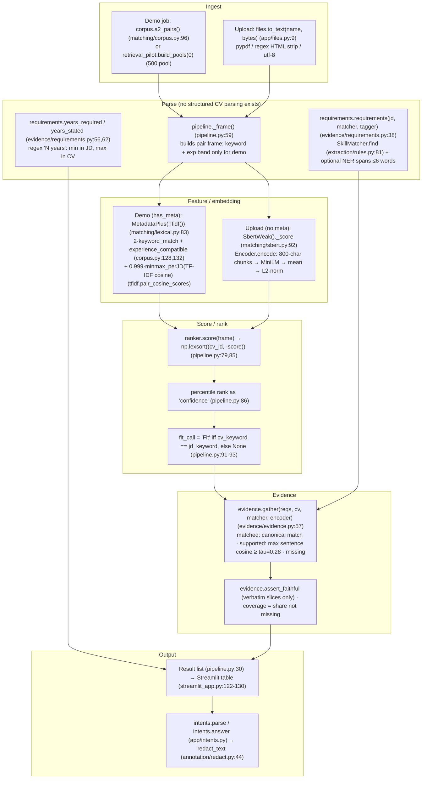
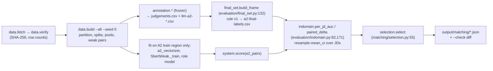

# 01 — Project map

*Written 11 Oct 2026 against branch `feat/stage2-rerank` at `5fc2856`. Line numbers refer to
that commit. "Verified" means I ran or read it; "inferred" means I did not.*

## 1. What the system does, end to end

A recruiter gives the system one job description (JD) and a pool of resumes (CVs). Each CV
gets a single relevance score, and the CVs are sorted by it. Next to the ranking, each CV
gets an **evidence list**. That list is the JD's skills (looked up in a ~9,100-alias
vocabulary built mostly from ESCO), each marked *matched* (the CV names the skill),
*supported* (a CV sentence is semantically close, MiniLM cosine ≥ 0.28) or *missing*, with
verbatim quotes. **Which scorer runs depends on the input.** For the built-in Djinni demo
jobs, the CV's and JD's `Primary Keyword` metadata field decides the ranking: a CV whose
keyword matches the JD's always ranks above one that does not. TF-IDF cosine orders CVs
within each group, and the Fit / No Fit call is just "keywords equal". For uploaded files
there is no metadata, so a MiniLM bi-encoder fine-tuned on keyword-derived weak pairs ranks
the CVs and no Fit call is made. A rule-based chat box answers questions such as "why is 1
above 3" from templates. Nothing generative runs at inference. Most of the repository is
not this product. It is an evaluation harness (a "ladder" of
rules → TF-IDF/BM25 → SBERT → cross-encoder) that scores each method against 600
hand-labelled Djinni (JD, CV) pairs. The research has moved past what the app runs (see §2).

## 2. Status at a glance: product and research have diverged

| | What the **app / `pipeline.py`** runs | Where the **research** is |
|---|---|---|
| Ranker (Djinni demo) | `metadata + TF-IDF`, reading `Primary Keyword` and experience bands at inference (`pipeline.py:26`, `pipeline.py:46-51`, `matching/lexical.py:83-112`) | D53 (6 Oct) **forbids metadata at inference**. The replacement, X2 = extracted role + experience + TF-IDF (`matching/extracted.py`), scores AUC 0.850 but **misses the registered retrieval bar** (Recall@50 0.779 < 0.80), so it was **not adopted** (`plan/2026-10-06-extraction-and-rerank/16-p7-stage1.md` §4–5) |
| Ranker (uploads) | `SbertWeak()` on text variant **v1**, the variant with CV `Position` in the text (`pipeline.py:52-56`, `matching/sbert.py:129`) | Stage 2 = SBERT weak (P8, `17-p8-stage2.md` §6). Every trained reranker (R1–R3) was harmful or not resolved |
| Fit / No Fit call | `cv_keyword == jd_keyword` (`pipeline.py:91-93`) | No text-only classifier has been adopted |
| Next step | — | **P9**, "Pipeline and UI read extracted fields only", is **not done** (`09-progress.md`, "Next steps" item 4) |

**So the shipped demo violates a live rule (D53).** Its headline number (AUC 0.849) is the
pre-D53 figure that D53 was written to retire.

## 3. Repo map

Status key: **live** = on the app's path, or a live record and its check · **research** =
current experiment and committed record, not in the app · **superseded** = record kept for
history, its check runs only `--cold` · **frozen** = read-only by decision · **rejected** =
evaluated, lost, and kept for the record · **tooling**.

### Top level

| Path | Purpose | Status |
|---|---|---|
| `AGENTS.md` / `CLAUDE.md` | Live rules for agents and contributors (`CLAUDE.md` only includes `AGENTS.md`) | live |
| `README.md` | Overview, results, commands | **partly stale** (§6) |
| `docs/decisions.md` | Decision log D1–D55 | live |
| `docs/proposal/` | Module proposal v2 and v3 | reference |
| `docs/annotation-guide.md` | What Good / Potential / No Fit mean for annotators | frozen |
| `docs/data/` | Data catalog, per-source cards, **committed manifests**: labels, pair ids, partitions, LLM labels | live; the labels live here |
| `plan/` | 17 dated plans and their implementation records. The current ones are `2026-10-06-extraction-and-rerank` and `2026-10-07-shortlist-recall` | history + live records |
| `output/` | Committed JSON records (metrics, costs, configs) that the `--check` commands diff against | live |
| `notebooks/01–11` | EDA and reporting. 08–11 report the 27 Sep reset | 01–07 historical; 08–11 **pre-D53** |
| `tests/` | 48 test files; 639 tests pass in ~55 s (verified 11 Oct) | live |
| `data/` | Git-ignored working set: raw downloads, caches, model weights. `data/vocab/skills.csv` is the one tracked file | required, not committed |
| `logs/` | Git-ignored run logs | local only |
| `.claude/agents/a1-judge.md` | The LLM annotator's prompt (instrument `5d986c82`) | frozen |

### `src/candidate_screener/`

| Module | Purpose | Status |
|---|---|---|
| `pipeline.py` | `screen(jd_text, cvs, …)` → ranked `Result`s with evidence. The product entry point | **live** (pre-D53 ranker) |
| `config.py` | Canonical paths (`data/raw`, `processed`, `output`, …) | live |
| `checks.py` | Runs every `--check`, in warm and cold tiers (D55) | tooling |
| `reporting.py` | Chart styling for the notebooks | tooling |
| **`app/`** `streamlit_app.py` | Streamlit UI: demo job or upload, ranked table, evidence, chat | **live** |
| `app/intents.py` | Regex intent parser and templated answers | live |
| `app/files.py` | `.pdf` (pypdf), `.html` (regex strip) and `.txt` → text | live; **the only "parser"** |
| **`matching/`** `base.py` | `System` protocol / `BaseSystem` (fit, score, card) | live |
| `matching/corpus.py` | A2 pair frames, text variants v1/v2, `keyword_match`, `experience_compatible` | live |
| `matching/lexical.py` | `Tfidf`, `Bm25`, and `MetadataPlus` (metadata level + per-JD min-max text score) | live |
| `matching/rules.py` | `Random`, `KeywordMatch`, `Metadata`, `SkillOverlap`, `metadata_classifier` | live (rules) / research |
| `matching/sbert.py` | `Encoder` (800-char chunk-mean, `.npz` cache), `SbertZeroShot`, `SbertWeak` | live |
| `matching/neural.py` | MiniLM id, offline loading, seeds, fingerprints | live |
| `matching/extracted.py` | X1–X4: role / experience extracted from text, plus a text rung | research (not adopted) |
| `matching/role_filter.py` | Y and Z rungs: hard and soft role filters | research (early-stopped / not adopted) |
| `matching/retriever.py` | `Retriever` protocol | research (no src importer) |
| `matching/cross_encoder.py` | 4a (A1-trained) and 4b (weak-trained) cross-encoders | **rejected** (AUC 0.488 / 0.661) |
| `matching/hybrid.py` | Learned logistic combination of text rungs | **rejected** (not resolved) |
| `matching/ladder.py`, `selection.py` | Which rungs are scored, and the registered "cheapest unbeaten rung" rule | evaluation harness |
| **`evidence/`** `requirements.py` | JD → skill requirements (+ optional tagger spans), `years_required`/`years_stated` regexes | live |
| `evidence/evidence.py` | matched / supported / missing per requirement, `assert_faithful`, `calibrate_tau` | live |
| **`extraction/`** `rules.py` | `SkillMatcher`: longest-match trie over `data/vocab/skills.csv` | live |
| `extraction/vocab.py` | Builds the vocabulary (ESCO ICT + data-jobs + regex) | live (builder) |
| `extraction/ner.py` | MiniLM BIO skill tagger trained on SkillSpan | live but **optional**: the app falls back silently when the weights are missing (`streamlit_app.py:28-35`) |
| `extraction/role_family.py`, `experience.py`, `role_set.py`, `jd_title.py`, `title_profile.py` | Text → role family / experience / title, for X, Y and Z rungs | research |
| `extraction/normalise.py`, `skillspan.py`, `evaluate.py`, `metrics.py`, `experience_eval.py` | Extraction benchmarks and records | measurement |
| **`evaluation/`** `final_set.py` | Builds the 600-pair Fit / No Fit reference (D41) | **live; the ground truth** |
| `evaluation/indomain.py` | Per-JD AUC, within-family AUC, paired deltas, classifier stats | live (v1 record superseded; v2 exploratory) |
| `evaluation/resample.py` | JD-level bootstrap | live |
| `evaluation/stage1.py`, `stage2.py`, `ordering.py`, `dev_pools.py`, `shortlist_dev.py`, `shortlist_final.py`, `text_leak.py` | The current research records | research |
| `evaluation/group_gaps.py`, `latency.py` | AUC by experience band / stratum; wall time | live, **no `--check`**, both measure the pre-D53 pipeline |
| `evaluation/retrieval_pilot.py` | 500-candidate pools (10 judged + 490 random) | superseded record, but `build_pools` is **still used by the app** (`streamlit_app.py:69`) and by stage 1 |
| `evaluation/retrieval.py`, `metrics.py`, `classification.py`, `a1_secondary.py` | A1-era retrieval and classification | superseded |
| **`baselines/`** `tfidf.py`, `bm25.py`, `lexical.py` | Shared TF-IDF / BM25 / tokeniser functions | live (as a library) |
| `baselines/run.py`, `classifier.py`, `skills.py` | The frozen Phase-4 A1 baseline | superseded (record kept) |
| **`data/`** `sources.py`, `fetch.py`, `verify.py`, `profile.py`, `build.py`, `verify_derived.py`, `ids.py` | Source registry → download → SHA-256 verify → derived artefacts | live |
| `data/a2_finetune.py` | A2 document-level train / eval partition (D19) | live |
| `data/weak_pairs.py` | Keyword- and experience-labelled training pairs for SBERT weak | live |
| `data/fit_split.py`, `pools.py`, `dataturks.py` | A1 re-split, A1 pools, DataTurks repair | live as dependencies, A1-era |
| **`annotation/`** (`sample`, `queue`, `session`, `ui`, `llm_recheck`, `prompt_calibration`) | The labelling campaign and the LLM judge | **frozen** (D42); `sample.cv_text` / `load_english` are still imported by `corpus` |
| `annotation/redact.py` | Regex masking of URL, email, phone and long digit runs | **live** (every UI string passes it) |
| **`rerank/`** `base`, `batch`, `models`, `scoring_batch` | Stage-2 rerankers trained on the LLM 0–100 batch | **rejected** (no reranker beats SBERT weak) |

"Dead" in the strict sense (no importer and no record) applies to almost nothing. The
codebase keeps every experiment alive for reproducibility. The cost: roughly 2,100 of the
20,200 lines in `src/` (~10%) are on the app's runtime path. The rest is the data layer,
evaluation, annotation and history.

## 4. Pipeline diagram

### 4a. What runs when a recruiter presses **Screen**

### 4b. Offline: how a number in `output/` is produced

## 5. How to run it from scratch

I ran only `uv run pytest` (639 passed, 0 skipped, 55 s, with `data/` present). I did **not**
run fetch or build on a clean machine. The steps below are read from code and docs.

| Step | Command | Needs | Produces |
|---|---|---|---|
| 1. Environment | `uv sync --all-groups` | Python 3.12, `uv` | venv with torch CPU, sentence-transformers, streamlit |
| 2. **Model weights (undocumented)** | e.g. `uv run python -c "from sentence_transformers import SentenceTransformer as S; S('sentence-transformers/all-MiniLM-L6-v2')"` | Internet, once | HF cache entry. **Every neural path loads with `local_files_only=True`, and importing `matching/neural.py` sets `HF_HUB_OFFLINE=1` (`neural.py:16`).** No README or data guide says to pre-download MiniLM. Only plan `01-audit.md:199` notes "it is in the local cache". On a fresh machine SBERT, the evidence encoder and the NER all fail, and the app silently drops to TF-IDF / no tagger / no "supported" status (`pipeline.py:52-56`, `streamlit_app.py:31-46`) *(inferred from code)* |
| 3. Raw data (~676 MB) | `uv run python -m candidate_screener.data.fetch --all` then `… data.verify --all` | **Kaggle API token** (livecareer PDFs); **ESCO** needs a manual registered download. `fetch` prints the steps | `data/raw/*` |
| 4. Derived artefacts | `… data.build --all --seed 0` then `… data.verify --derived` | step 3 | splits, partition, pools, weak pairs under `data/processed/` |
| 5. Reference labels | `… evaluation.final_set --check` | committed manifests only | PASS lines (no data needed) |
| 6. Models + records | `… checks --cold --all` (~50 min, 22 cores; `stage2` alone took **3 h 56 min** cold on 9 Oct per `logs/stage2-cold.log`) | steps 2–4 | retrains TF-IDF / SBERT weak / NER / role model / cross-encoders into `data/processed/`, diffs every `output/` record |
| 7. Evidence threshold | committed as `output/evidence/tau.json` (0.28); rebuild with `… evidence.evidence --calibrate` | SkillSpan raw | tau |
| 8. App | `uv run streamlit run src/candidate_screener/app/streamlit_app.py` | steps 2–4 for the demo; uploads work with only step 1 | UI at `localhost:8501` |

**Secrets:** Kaggle token only. No LLM key is needed: dispatch to Claude is closed in code
(`DispatchClosed`, D42). **Expected outputs:** every `--check` prints `[PASS]`, and the app
ranks a demo job in about 0.84 s per 500 CVs (`output/matching/latency.json`, measured
without the evidence encoder).

**Memory warning (AGENTS.md):** `role_family`, `shortlist_dev`, `dev_pools`, `scoring_batch`
and `stage2` each peak above 4.5 GB.

## 6. Where code and docs disagree

| # | Docs say | Code / data says | Where |
|---|---|---|---|
| 1 | AGENTS.md rule 6 / D53: "No metadata at inference" | The default pipeline and the demo UI read `Primary Keyword` and experience bands, and the Fit call **is** keyword equality | `pipeline.py:46-51,91-93`; `streamlit_app.py:104` |
| 2 | README "Results (27 Sep)" presents metadata + TF-IDF 0.849 as **selected** | Superseded by D53. The current best text-only figures are X4 0.855 / X2 0.850 on `text_v2`, neither adopted. README never mentions stage 1, stage 2 or shortlist recall | `README.md:17-34` vs `16-p7-stage1.md` |
| 3 | README layout: "decision log (D1–D49)" | The log runs to D55 | `README.md:56` |
| 4 | `17-p8-stage2.md` and `09-progress.md`: "cold `stage2 --check` still owed" | A local log shows it ran: `PASS stage2 14170.6 s`, exit 0, 9 Oct 20:53. The plan files were not updated. The log is git-ignored, so the evidence exists only on this machine | `logs/stage2-cold.log` |
| 5 | `redact.py` docstring: "applied to everything that reaches a human". Proposal v3: "Remove or mask names, addresses, age, gender, nationality" | `redact_text` masks URL, email, phone and digits only, and **says it does not remove names**. Nothing masks age, gender or nationality | `annotation/redact.py:8-17`; `docs/proposal/…-v3.md:227` |
| 6 | `pipeline.py` docstring: the Fit call comes "from a rung with a threshold fitted off the final set (D46)" | There is no fitted threshold. It is string equality of keywords | `pipeline.py:10-11` vs `:91-93` |
| 7 | `streamlit_app.py` docstring: "Everything shown passes `annotation.redact`" | The ranked table shows `cv_id`, which is the upload's **filename** (`streamlit_app.py:109`). Filenames are often `Firstname_Lastname.pdf` and are not redacted | `streamlit_app.py:122` |
| 8 | README: "Extraction splits by role (D49): a MiniLM tagger for job postings" | The tagger is loaded inside `try/except Exception: return None` (`streamlit_app.py:31-35`). If the weights are absent, the app runs without it and says nothing | |
| 9 | The `SbertWeak` used for uploads is described as the "text-only" choice | It is the **v1** model, fine-tuned on CV text that **includes** `Position`. The D53-compliant `SbertWeak("v2")` exists but is not wired in | `pipeline.py:54`; `sbert.py:133` |
| 10 | AGENTS.md rule 8: "Decide before you look… anything seen earlier is `exploratory`" | The D48 selection picked `metadata + TF-IDF`, a rung marked **`exploratory`**. The ladder docstring says only held-out rungs test the rule | `matching/ladder.py:3-6,57` vs `indomain-metrics.json` `selection` |
