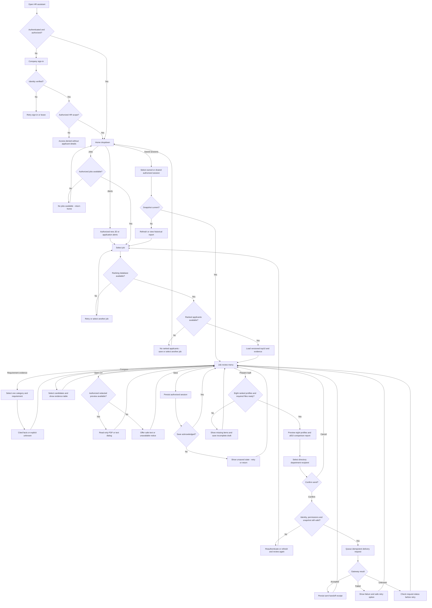

# Conversation design process

## 1. Discover the HR workflow

HR hiring-team employees currently move between JDs and manually inspect many CVs
to determine whether stated requirements are supported. Their main questions are
which applicants are highest ranked, what evidence supports the comparison, which
requirements remain uncertain and what to pass to the hiring department.

Start each design review with one end-to-end task: select a newly posted role,
review its top10, inspect an uncertain qualification, prepare the top8 and hand
the package to the hiring department. Document the authorized user, trigger,
required data, decision point, success condition and recovery for every step.
Use invented applicants in design walkthroughs; feedback is interaction feedback,
not new Fit judgements or entity gold.

## 2. Freeze a capability inventory

| Intent/menu action | Required context | Assistant output | Completion |
|---|---|---|---|
| View alerts | Authenticated HR identity and authorized events | New JD/application dropdown | Event opened; read status stored for that HR |
| Select job | Authorized open-JD list | JD title, requirement summary and ranking availability | Active JD bound to a versioned snapshot |
| Review top10 | Complete ranking result and accessible CVs | Ordered shortlist with evidence statuses | Up to10 actual applicants displayed |
| Review requirement | Selected requirement/category | Skills, knowledge, title, degree or experience evidence | Cited statements; missing/unknown distinguished |
| Preview CV | One selected candidate in snapshot | Read-only redacted PDF/text dialog | Preview closed; active review unchanged |
| Compare candidates | Two dropdown-selected candidates or all10 report | Requirement-by-candidate evidence table | Source-linked comparison displayed |
| Prepare top8 | Same snapshot and ranks1–8 | Package preview and incomplete-item list | Eight-person draft or explicit blocked state |
| Generate session report | Authenticated session/JD/snapshot | Versioned report comparing10 and identifying top8 | Report saved and available to authorized HR |
| Send to hiring department | Complete reviewed package and directory recipient | Exact recipient, contents and confirmation dropdown | Delivery status persisted; receipt available |
| Save/resume session | Authorized owner and session ID | Last safe state and freshness notice | Session saved or safely restored |

Entities are source-supported mentions, not automatic proof of qualification.
Experience must distinguish total tenure from tool-specific tenure. An absent
mention is not a confirmed gap; missing extraction is not zero entities. Current
human entity-span gold covers four categories; experience is a separately
provenanced extraction/rules output, not an invented fifth gold label.

## 3. Define persona and language

Proposed working name: **Hiring Desk**; brand name requires confirmation. The
voice is warm, composed, formal and evidence-conscious. It is helpful without
being overly familiar, critical without dismissing applicants, and never claims
certainty beyond the source material. Use job-related criteria and neutral
candidate IDs in summaries.

The20October [conversational QA amendment](06-hr-conversational-qa-amendment.md)
supersedes the original dropdown-only interaction. HR can type focused questions
and follow-ups; dropdowns remain for context selection and operational actions.
Answer directly and ask one narrow clarification only when necessary.
Prefer one or two sentences; show lengthy comparisons in tables, previews or a
report. Avoid monologues, speculative personality judgements, unsupported hiring
recommendations and inflated language such as “perfect candidate”. State “ranked
first in this snapshot” rather than promising the best employee.

Operational confirmations remain explicit UI choices. Add st.chat_input and a
persistent two-sided transcript for QA. Preview controls may close/scroll a
read-only dialog. No uploader or media input is added. The existing upload/interview
demo remains a separate legacy experience. Earlier menu scripts describe guided
actions; the amendment adds conversational examples and turn-processing flow.

## 4. Establish dialogue state and transitions

Store typed state: authenticated HR subject, authorization scope, session ID,
active JD/version, ranking-run ID, snapshot digest, top10 IDs/order, proposed top8,
selected candidates/requirement, active menu, report/package versions and delivery
status. Store references and bounded validated answers; conversation history is
not a source of applicant facts. Do not persist credentials or bearer tokens in
the conversation record.

| State | One question / choices | Transition condition |
|---|---|---|
| Signed out | Authenticate via company sign-in | Verified identity callback |
| Home | “What would you like to review?” Jobs / Alerts / Saved sessions | Permission-checked selection |
| Job selection | “Which role?” Authorized JD dropdown | Job still accessible |
| Ranking unavailable | Retry / Review another job / Return home | No inferred or fabricated ranking |
| Job review | View top10 / Review requirement / Open CV / Compare / Prepare top8 / Save / Change job | Valid snapshot |
| Candidate/requirement selection | One narrow candidate or requirement dropdown | ID belongs to current snapshot |
| CV preview | PDF / Text / Return to review | Authorized, redacted representation exists |
| Package review | Review report / Review top8 / Continue to recipient / Cancel | Coverage and files checked |
| Recipient review | Hiring department from authorized directory | Recipient belongs to active JD department |
| Send confirmation | Confirm send / Cancel | Fresh package, permission and identity revalidated |
| Delivery status | View receipt / Return to review / Check status | Status is queued/sent/failed/unknown, not guessed |
| Session restored/stale | Refresh rankings / View historical report / Select another job | Historical state cannot send until refreshed |

Switching jobs invalidates candidate selections, top8 drafts and send confirmation.
Keep saved historical reports labelled with their original job/run version. New
applicants or changed JDs trigger a freshness notice; never silently replace a
reviewed package with newly ranked candidates. An alert does not interrupt an
open preview or automatically send a package.

## 5. Write sample dialogues before implementation

**Normal review and handoff**

> Hiring Desk: Welcome back. What would you like to review?  
> Dropdown: Jobs / New alerts / Saved sessions
>
> HR selects: Jobs
>
> Hiring Desk: Which role would you like to review?  
> Dropdown: authorized open roles
>
> HR selects: Senior ML Engineer
>
> Hiring Desk: Ten applicants are ranked for this role. What would you like to inspect?  
> Dropdown: Top10 / Requirement evidence / Open CV / Compare / Prepare top8 / Save session
>
> HR selects: Requirement evidence, then PyTorch experience
>
> Hiring Desk: Two CVs state tool-specific experience; three mention PyTorch without a duration. Which applicant would you like to inspect?  
> Dropdown: candidate IDs from the current top10
>
> HR selects: Applicant004, then Text preview
>
> Hiring Desk: The cited passage is highlighted in the read-only preview. What next?  
> Dropdown: Return to review / Compare another applicant
>
> HR selects: Prepare top8
>
> Hiring Desk: The draft includes ranks1–8 and a comparison of all10. What would you like to review?  
> Dropdown: Eight profiles / Comparison report / Continue to recipient / Cancel
>
> HR selects: Continue to recipient, then the authorized hiring department
>
> Hiring Desk: Send this package to the displayed department address?  
> Dropdown: Confirm send / Cancel
>
> HR selects: Confirm send
>
> Hiring Desk: The package is queued. What would you like to do next?  
> Dropdown: Check delivery status / Return to review

The figures in the example are fictional script fixtures, not measured outcomes.
“Queued” becomes “sent” only when the mail service confirms delivery handoff;
it does not assert the recipient read it.

**Recovery examples**

> Ranking unavailable: “The ranking results are unavailable. What would you like to do?”  
> Dropdown: Retry / Select another job / Save and return home
>
> Fewer applicants: “Six applicants are ranked. An eight-person package cannot be completed yet.”  
> Dropdown: Review six / Save draft / Select another job
>
> Unknown qualification: “No cited passage establishes this qualification. What would you like to inspect?”  
> Dropdown: Open CV / Review another requirement / Return to review
>
> Expired login: “Your sign-in expired. Sign in again to continue.”  
> Dropdown: Company sign-in / Leave workspace
>
> Delivery uncertain: “The mail service has not confirmed this request. Check its status before trying again.”  
> Dropdown: Check status / Return to review

## 6. Map happy paths and errors

## 7. Walk through, test and revise

Walk through each script with synthetic data and review one decision per turn.
Record confusing wording, missing menu options, dead ends and unnecessary turns.
Test accessibility, keyboard navigation, narrow-screen previews and alerts while
a review is active. Version the dialogue copy/menu schema and keep a persistent
issue list linked to acceptance tests. Validate authorization and irreversible
action handling with deterministic tests, not only an LLM-generated conversation.

Freeze a reviewed menu/state specification before coding, then measure task
completion, turns to completion, clarification/recovery counts, report correctness
and delivery-status accuracy. Recruiter experience feedback does not become
ranking-training labels. Repeat the design loop on development scenarios; keep
the final QA evaluation scenarios separate from wording experiments.
