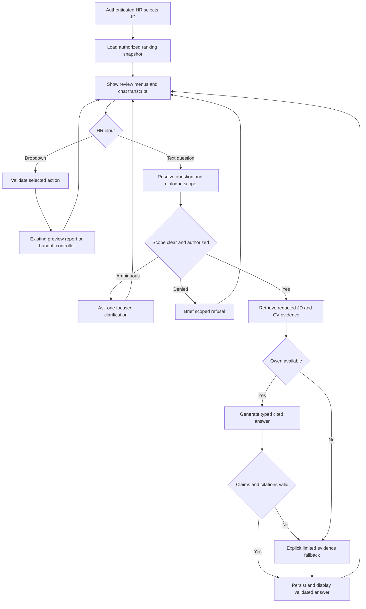

# HR conversational QA amendment

20 October 2026; updated 21 October. Status: conversational QA implemented;
completion and validation authorized in the
[approved completion plan](../../../plan/2026-10-21-chatbox-completion/README.md).
User direction: the goal is to communicate with HR, using a chatbox alongside
dropdown navigation and an LLM assistant such as Qwen-Instruct. This supersedes
the earlier prohibition on typed HR questions. Authentication, authorization,
redaction, existing ranking order and explicit action confirmations remain.

## 1. Product outcome and conversation design

HR can discuss the selected job and its applicants naturally, rather than only
operate menus. Dropdowns establish the job, candidates and operational actions;
typed questions support fact finding, explanation, comparison and follow-ups.
The assistant is warm, professional, brief and critical about evidence. It helps
the HR reviewer make a decision; it does not make hiring commitments.

Display a persistent chat transcript alongside the existing review workspace.
Use st.chat_input for text questions, st.chat_message for both participants, and
the existing dropdowns for job selection, previews, reports and handoff. No file,
image, video, microphone or attachment input is introduced. Authentication fields
remain outside chat. On entering a job, greet HR with the selected role and offer
three example questions. Do not greet again on every Streamlit rerun.

Give a direct answer first, followed by concise supporting evidence and uncertainty.
Prefer two to four sentences; use a compact table for candidate comparisons.
Ask at most one focused clarification when essential. Do not append a question
to every completed answer. Detailed source passages open through authorized
evidence controls. Suggestions are optional shortcuts, not the only input route.

### Dialogue inventory

| HR intent | Example | Expected response |
|---|---|---|
| Understand requirements | What does this role require? | Summarize stated JD requirements with JD citations; distinguish inferred terms. |
| Candidate facts | What degree does candidate 2 have? | Retrieve that CV; cite its statement, or say evidence is unavailable. |
| Suitability explanation | Why is candidate 1 ranked first? | State the existing rank, describe evidence against JD criteria; do not claim the scoring model's causal reasoning without a score decomposition. |
| Comparison | Compare candidates 1 and 3 on Python experience. | Compare only their cited evidence; distinguish total tenure from Python-specific tenure. |
| Follow-up | What about their qualifications? | Resolve the prior candidate set and ask a clarification only if ambiguous. |
| Evidence challenge | Where does it say that? | Reopen the cited excerpt from the same snapshot; correct unsupported prior wording. |
| Missing evidence | Does candidate 4 have AWS certification? | Distinguish a mention, a certification claim and a verified/current credential. |
| Operational request | Prepare the shortlist report. | Offer the existing report action; do not execute an operation from model prose. |
| Out-of-scope request | Email this candidate or arrange an interview. | Briefly explain the scope and offer an allowed review action. |

### Example conversation

Illustrative synthetic dialogue; it does not describe an actual applicant.

HR: “Which applicant is the strongest match for this role?”

Assistant: “Candidate 1 is highest in the saved ranking. Their CV mentions Python
and model deployment, both requested in this JD [JD-R1] [CV1-E2]. This is evidence
supporting the match, not proof of how each feature affected the model score.”

HR: “What about candidate 2?”

Assistant: “Candidate 2 is ranked second. Their CV mentions Python [CV2-E1], but
the retrieved evidence does not establish production deployment experience. I can
compare their deployment evidence with candidate 1.”

HR: “Do they have five years of Python?”

Assistant: “Do you mean candidate 2, or both candidates?”

HR: “Candidate 2.”

Assistant: “I cannot establish five years of Python from the available evidence.
The extraction table's total-experience number does not establish time using a
particular skill.”

## 2. Data and model boundary

Reuse the supplied a2-cv-extraction.csv, a2-jd-extraction.csv, a2-x2-scores.csv and
authorized redacted CV/JD text from the current adapter. No ranks are recomputed.
These exports supply 60 JDs and 600 ranked pairs, ten candidates per JD. This is
an A2 benchmark review pool, not a production company-wide candidate search.

Extraction tables are retrieval aids and unverified model outputs. They cannot
establish gold labels or exact original-document spans. Source-backed answers
must retrieve the relevant redacted text; when source text is unavailable, label
table-only information explicitly. Unknown degree/knowledge/title fields remain
unknown unless the source supports a specific answer. No final labels, prohibited
metadata, raw PII or another user's transcript enters model context.

Use the existing configured Qwen-Instruct inference adapter as the first
generative baseline, with frozen pretrained weights. Inventory the actual local
checkpoint, tokenizer, inference endpoint, context limit and runtime before
selecting configuration. Do not assert that Qwen is running because a wrapper
exists. Do not download weights, train at startup or select a new model size
without a reviewed runtime configuration. No fine-tuning is required for this
first release; future adaptation is justified only by measured failure cases and
a separate data/resource plan. The old QA experiment is not restarted here.

If Qwen is absent or times out, keep the chatbox available and clearly identify
the limited deterministic evidence response. Never present a canned response as
an LLM-generated answer. A deployed LLM release requires a real inference smoke
test as well as synthetic provider tests.

## 3. Turn-processing architecture and contracts

1. Authenticate and authorize the session and selected snapshot on every turn.
   Validate input length, bounded history and single-flight turn identity.
2. Resolve scope: active JD, explicit candidate references, prior comparison set,
   category and pending clarification. Explicit current references override old
   ones. Unknown/ambiguous references trigger one clarification; do not guess.
3. Route to requirement QA, candidate QA, comparison, rank explanation, evidence
   lookup, operational guidance or out-of-scope response. Model intent suggestions
   are schema-validated and cannot authorize an operation.
4. Retrieve only authorized source chunks for the selected JD/candidates. Reuse
   existing retrieval where compatible; initially use deterministic scoped passage
   retrieval, not a new embedding database. For comparisons, reserve evidence
   budget for each requested candidate and the JD. Relevant facts late in long
   CVs must be retrievable; do not send only the document prefix or entire CVs.
5. Construct a token-bounded prompt with separate system rules, current question,
   resolved state, limited prior turns and evidence records. Preserve negation,
   dates and qualification context. CV text and history are untrusted data.
6. Qwen returns a typed answer containing answer kind, individual factual claims
   with evidence IDs, optional clarification, and suggested permitted action IDs.
   Candidate/rank/score references must match the backend snapshot. References
   must resolve to the authorized candidate, document and snapshot.
7. Validate the output and render only supported claims. Citation membership
   alone does not prove entailment: protect numbers, units, negation, credentials,
   tenure and comparison qualifiers with explicit checks and tests. For claims
   whose support cannot be checked reliably, display source excerpts and an
   uncertainty statement instead of unchecked generated prose. One bounded
   repair attempt may correct a schema error; repeated failure uses the fallback.
8. Persist the completed, validated exchange atomically with its snapshot and
   evidence references, generation mode/model identity and turn ID. Never store
   tokens or internal model reasoning. Display storage failures honestly.

Evidence record: evidence_id, owner kind and ID, JD/snapshot/document digest,
redacted excerpt, display start/end and coordinate space. Page is optional and
must not be invented. Answer record: turn_id, status, resolved scope, claims,
citations, clarification, suggested action IDs and inference provenance. Raw model
output is not a successful persisted assistant response.

The system prompt establishes the HR role, evidence-only answering, concise tone,
uncertainty handling and prohibition on invented ranks/actions. Low-variance
decoding improves repeatability; it does not establish factual correctness.

## 4. Memory, action safety and recovery

Persist conversation under the existing authenticated HR session. Track active
JD/snapshot, current candidates/category, comparison set and pending clarification
separately from prose. Prior assistant answers are never authoritative CV evidence.
Restore validated exchanges after reconnect; reauthorize citation previews.

Changing the JD starts a distinct review context and clears candidate references
and pending questions. Keep previous reviews accessible through saved sessions.
An updated source/ranking snapshot requires an explicit refresh; historical chat
remains labelled with its original snapshot. Do not apply old “candidate 2” or an
old send confirmation to a new ranking.

Typed requests may propose navigation to a preview/report/package action. The
existing controller executes only a validated HR UI selection. Department sending
still requires the separate reviewed package/recipient confirmation and configured
gateway. A model tool call or “yes” in chat is not confirmation to send. No candidate
contact, appointment scheduling, upload or arbitrary tool execution is added.

## 5. Implementation sequence and ownership

| Step | Change | Reviewable result |
|---|---|---|
| A | Inventory existing Qwen, legacy QA and portal interfaces; define typed turn/evidence/state contracts. | Document supported runtime and reusable modules; no wholesale legacy UI import. |
| B | Add portal_qa.py and typed schemas for scoped resolution, retrieval and validation. | Backend service usable with synthetic providers, independent of Streamlit. |
| C | Extend portal_store.py/controller with bounded transcript, turn IDs and context transitions. | Owner-isolated resume, duplicate-safe reruns and stale-context recovery. |
| D | Add chat input/transcript and citation controls to portal_ui.py. | Chat and dropdowns share one authenticated active review and selected candidates. |
| E | Integrate configured Qwen generation with timeout/schema validation and explicit fallback. | Actual grounded multi-turn HR conversation; model identity/mode visible. |
| F | Run frozen walkthroughs, negative tests and local inference smoke test. | Measured results, known limitations and deployment requirements recorded. |

After plan approval, use a scoped implementation branch and commit the plan.
Delegate typed QA/retrieval, transcript/state and UI/evaluation work with distinct
file ownership. Integrate through the contracts above. Preserve the current
working tree and isolated legacy experience. Do not alter research/training code
or reopen annotation to implement the chatbox.

## 6. Acceptance and evaluation

Freeze synthetic JD/CV scenarios before tuning prompts. Tests must run without
real applicant data, downloaded weights or live company services. Include:

- Typed question and streamed-or-completed answer coexist with dropdown navigation;
  no upload/media input appears. Full transcript survives reruns and authenticated resume.
- Explicit candidate facts, multi-candidate comparisons, JD requirements and rank
  explanations cite the correct snapshot/owner; score wording preserves semantics.
- Follow-ups, ambiguous pronouns, unknown IDs, new JD selection and changed ranking
  resolve correctly without leaking prior context or silently guessing.
- Retrieval finds evidence beyond document prefixes; excerpts preserve negation,
  expired credentials, missing evidence and total-versus-skill-specific experience.
- Fabricated citations, foreign IDs, invented numbers, malformed JSON, injected
  CV instructions and requests for unauthorized documents fail safely.
- Timeout/unconfigured model, rejected output and save conflict produce truthful
  recovery states. Repeated Streamlit reruns do not duplicate completed turns.
- Chat cannot send email, change ranks, invent Fit probabilities or bypass confirmation.

Record scenario completion, reference-resolution correctness, citation validity,
claim support, abstention correctness and response latency with denominators.
Separate deterministic invariant checks from human judgement of answer usefulness,
clarity and warmth. Do not report synthetic QA scores as extraction accuracy or
recruitment benchmark performance. Before final evaluation, agree a review rubric
and freeze examples; report actual model/runtime and inference availability.

Show regression tests failing when guards are removed. Run focused tests, the
full suite once stable, and affected registered checks with retained logs. D55
applies if model/training code changes or a plan is marked complete. No claim of
production readiness follows from local synthetic tests alone.

## 7. Open decisions and explicit defaults

Resolved by current user instruction: typed text questions are in scope alongside
dropdown operational controls; the assistant's primary goal is communication with HR.

Proposed default: reuse the existing configured Qwen-Instruct runtime, frozen
weights, on-demand source retrieval and concise evidence-grounded generation.
Actual checkpoint/hardware/endpoint availability must be inventoried in step A.
If unavailable, report the missing runtime and keep the explicit fallback usable;
do not claim an LLM release complete. Hosted processing of applicant data requires
an explicit permitted deployment/data-handling configuration, not an assumed API.

Corporate SSO, live event feed, directory/mail gateway, original PDF derivatives,
retention and hosting remain open in the main questions record. None blocks
planning or local authenticated chat against the supplied redacted source data.

## 8. Conversation flow

